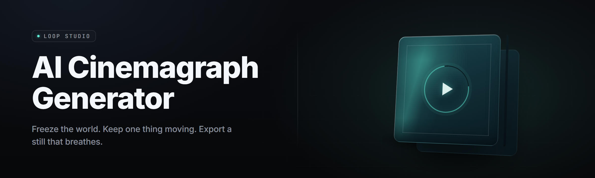

  
  
  

  

  
  

---

**Still frames that keep moving. Animate the loop, freeze the world, ship the cinemagraph.**

A Windows desktop studio that turns any photo or short clip into a seamless, hyper-local motion cinemagraph — flowing water in a frozen street, steam in an otherwise still café, wind in one lock of hair. Powered by a bundled motion-segmentation + optical-flow-aware inpainting pipeline. Extract, run the `.exe`, drop an image. That's the whole loop.

---

## 🧭 Overview

| Category | Details |
|---|---|
| What ship is this | Windows desktop studio (`.exe`) for generating AI cinemagraph loop animations |
| Primary input | Still `.jpg` / `.png` / `.webp`, or short `.mp4` / `.mov` (2–10 s) |
| Primary output | Looping cinemagraph `.mp4` / `.webm` / `.gif` + mask project file |
| Motion model | Segment-Anything-2 style matting + RAFT-derived optical flow for loop seams |
| Inpainting | Latent-diffusion inpaint stage that rewrites the static field around moving regions |
| Loop engineering | Seam-match warp, ping-pong option, 2s / 4s / 6s / 8s loop targets |
| Distribution | Landing page download → extract → run the `.exe` — no Python, no Node |
| Compute backend | CUDA 12.x (best), DirectML (any GPU), CPU fallback |
| Project format | `.cgproj` bundle — masks, flow, prompts, seed, render history |
| Batch | Queue 200+ sources, auto-name, per-item loop length override |

This is the desktop release doc. Everything below assumes you already have the archive from the landing page and are staring at an extracted folder.

---

## 🤔 What is a cinemagraph, exactly?

| Term | Explanation |
|---|---|
| Cinemagraph | A still photograph in which one isolated region moves in a perfect, endless loop |
| Loop seam | The frame where the last frame meets the first; the pipeline hides this seam |
| Motion mask | The per-pixel region designated as "alive" — water, steam, hair, fabric, smoke |
| Static field | Everything outside the mask; the inpaint stage reconstructs this from surrounding pixels |
| Optical flow | Per-pixel motion vectors that let the renderer warp the loop without tearing |
| Ping-pong loop | Forward-then-reverse playback trick that guarantees a seamless loop but reverses direction |
| Seam-match warp | Stronger method: the model re-times the source so frame N lands on frame 1 exactly |
| CineNet pass | The bundled neural pass that predicts the motion mask from a text or regional prompt |

Cinemagraphs sit between a GIF, a live photo, and a video — one region alive, the whole frame locked. That constraint is what makes them hard: every pixel outside the mask has to stay pixel-identical, and the moving region has to loop without a tell.

Four things this generator buys you that a manual After Effects loop can't:

- Motion masking is predicted, not painted — prompt it or smear a brush region.
- The inpaint stage actually reconstructs pixels under the mask edge, so movement doesn't "float" on dead backgrounds.
- Seam matching happens at the flow level, not the frame level, so the loop survives at 60 fps.
- Export presets for Instagram, a website hero, or an OBS overlay are already wired.

---

## 😤 The Problem

- Manual cinemagraph work means hours of masking in After Effects; the brush edge is always slightly wrong.
- Free GIF loopers give you a visible hiccup every 2 seconds — dead giveaway, kills the whole illusion.
- "Motion" plugins make everything move, so the still-ness that defines a cinemagraph disappears.
- Video-diffusion tools like the generic ones morph the whole frame; the background drifts even when you asked it not to.
- Getting a clean loop means counting frames by hand and reading a timecode.
- Inpainting a moving region in a still frame usually means an Adobe subscription and a fast machine.
- There's no single tool that takes a photo, a rough region, and a phrase, and hands back a properly looped cinemagraph.
- Batch work across 50 fashion shots is completely unautomated in the manual world.

> Most "animator" tools animate the frame. A cinemagraph generator has to animate one region and hold every other pixel hostage.

---

## ⚙️ The Solution

| Problem | Solution in this tool |
|---|---|
| Manual masking is slow and imprecise | CineNet auto-masks from a prompt or a loose brush pass |
| Visible loop hiccups | Seam-match warp recomputes timing so the loop is mathematically closed |
| Whole-frame drift | Hard static-lock outside the mask; the input still pixel is re-imposed every frame |
| Background edge artifacts | Latent inpaint rebuilds the field under the mask boundary |
| Frame counting by hand | Loop targets in seconds; the renderer picks source frames automatically |
| Adobe dependency | Fully offline desktop tool, runs on the `.exe` you already downloaded |
| No batch workflow | Queue manager with per-item templates and auto-export naming |
| Loop length guesswork | Preview pad shows the loop live before you export |

---

## 🗂️ Table of Contents

- [Overview](#-overview)
- [What is a cinemagraph, exactly?](#-what-is-a-cinemagraph-exactly)
- [The Problem](#-the-problem)
- [The Solution](#-the-solution)
- [Key Features](#-key-features)
- [Motion Source Pipeline](#-motion-source-pipeline)
- [Masking & Region Tools](#-masking--region-tools)
- [Loop Engineering](#-loop-engineering)
- [Inpaint & Repair](#-inpaint--repair)
- [Export & Delivery](#-export--delivery)
- [Batch & Automation](#-batch--automation)
- [Comparison](#-comparison)
- [System Requirements](#-system-requirements)
- [Installation](#-installation)
- [Quick Start](#-quick-start)
- [Tips for best results](#-tips-for-best-results)
- [Hotkeys](#-hotkeys)
- [Known Issues](#-known-issues)
- [FAQ](#-faq)
- 

  

(#-download-1)

---

## 🎯 Key Features

| Feature | Description | Benefit |
|---|---|---|
| Prompt-to-mask | Type "steam", "river", "hair in wind" and CineNet segments the region | Skips the brush entirely on clean subjects |
| Region brush | Soft, hard, and flow-aware brush modes with a stabilizer | You fix the mask where the model guesses wrong |
| Seam-match loop | Flow-level re-timing closes the loop mathematically | No visible hiccup anywhere in the 2–8s range |
| Static-lock | Non-mask pixels are re-imposed from the source still each frame | Background stays frozen, on purpose |
| Latent inpaint | Diffuses new pixels under the mask edge | Movement doesn't float on dead pixels |
| Loop pad preview | Live scrubbing with a loop-boundary marker | You see the seam before you render |
| `.cgproj` projects | Self-contained bundle of masks, flow, prompts, seed | Hand a project to a teammate, they render it |
| Preset library | 40+ starting recipes: "Waterfall", "Candle", "Fashion Hair" | Fast on-ramp for common subjects |
| Multi-GPU queue | Distributes jobs across CUDA devices | Batch of 200 shots doesn't take all night |
| DirectML fallback | Runs on AMD / Intel GPUs without CUDA | Not locked to Nvidia |
| CPU render mode | Works without a GPU, just slower | Renders while you sleep |
| Export presets | Instagram, TikTok, web hero, OBS overlay | One click to the right aspect + bitrate |
| Metadata stamp | Optional EXIF-friendly loop metadata for provenance | Archive-friendly |

---

## 🎬 Motion Source Pipeline

**Source ingest** — accepts stills (`.jpg`, `.png`, `.webp`, `.tif`) and short videos (`.mp4`, `.mov`, `.mkv` up to 10 s). Video sources give the flow predictor more to work with and usually produce smoother loops.

- **Deterministic ingest** — same input, same seed, same output. Reproducible.
- **Color-managed** — sRGB, Display P3, and Adobe RGB inputs are converted to a working space before processing; export is tagged back.
- **Auto-orient** — reads EXIF orientation and rotates before processing; no sideways renders.

**Flow estimation** — RAFT-derived optical flow runs at 1/4 resolution first, then upscales, whole pass typically ~400 ms on an RTX 3060 for a 1080p source.

- **Bidirectional flow** — computes forward and backward flow so the seam stitcher has both ends to braid.
- **Flow-aware downscale** — resolution reduction respects edge gradients so thin motion (wire, thread) doesn't vanish.

**Temporal re-timing** — a small scheduler that decides where to sample the source so the loop length lands on your target exactly.

- **2s / 4s / 6s / 8s targets** — plus custom in frames.
- **Adaptive frame count** — picks 24, 30, 48, or 60 frames depending on chosen fps and loop length.
- **Drift guard** — if the re-timer would over-stretch and blur, it warns and offers the ping-pong fallback.

---

## 🖌️ Masking & Region Tools

**CineNet segmentation** — the primary masking model. Takes a text prompt and a source frame; returns a soft alpha over the moving region.

- **Multi-prompt** — comma-separate prompts ("steam, kettle spout") to merge regions.
- **Negative prompt** — push the model away from a region it keeps over-selecting, e.g. "not the whole counter."
- **Confidence overlay** — heatmap view so you can see where the model

**Brush stack** — for pinching, feathering, and fixing.

- **Soft brush** — classic feathered alpha; good for smoke and hair.
- **Hard brush** — sharp edges for glass, lip gloss, chrome trim.
- **Flow brush** — paints a direction field so the motion bends where you want it, not along the predicted vector.
- **Stabilizer** — velocity smoothing that keeps strokes from wobbling on tablet input.
- **Region lock** — pin a sub-region so global ops (feather, threshold) skip it.

**Mask arithmetic** — union / intersect / subtract between multiple masks in one project.

---

## 🔁 Loop Engineering

**Ping-pong** — the classic forward-reverse loop. Always seamless. Direction reverses mid-loop, so it's obvious to a careful viewer.

- **Recommended for:** subjects where arbitrary direction isn't a giveaway — smoke drifting in still air, light flicker, gentle foliage sway.

**Seam-match warp** — the flagship loop method. Re-samples source frames so the last frame lands exactly on the first under optical flow.

- **Recommended for:** directional motion — water flowing, hair blowing, fabric rippling.
- **Quality slider** — 0–100; higher values spend more compute closing residual flow error.
- **60 fps native** — loops stay clean even at high frame rates, which ping-pong cannot claim.

**Hybrid loop** — starts seam-match, falls back to ping-pong per-region if a sub-region fails to close under a quality threshold.

**Loop pad preview** — a scrub bar with a boundary marker. Pause on the seam; the renderer draws the residual flow as a thin line overlay so you can see how bad it is.

---

## 🩹 Inpaint & Repair

**Latent inpaint** — diffusion pass conditioned on surrounding pixels; rebuilds the static field under the mask boundary so movement doesn't look pasted on.

- **2-strength modes** — "light" for mask edges, "rebuild" for regions where the source still was unusable.
- **Prompt-biased** — paste a short description ("wet cobblestone, overcast") to improve plausibility of reconstructed texture.

**Edge blend** — post-inpaint poisson blend at the mask boundary; removes the last tell of a hard matte.

**Temporal consistency** — an optional pass that propagates inpaint across all loop frames so the reconstructed static field is identical frame-to-frame (not just "similar").

**Deband** — a light dithering pass that kills banding in gradient skies and flat walls, which cinemagraphs are especially prone to.

**Spot clone** — manual brush-based pixel clone; for when auto-inpaint gets a signature detail wrong.

---

## 📦 Export & Delivery

**MP4 (H.264)** — universal; the default export.

- **Presets:** 1080p 15 Mbps, 1080p 8 Mbps, 1440p 20 Mbps, 4K 40 Mbps.
- **Fast-start flag** — the moov atom is placed at the head, so web playback begins instantly.

**WebM (VP9 / AV1)** — smaller files with a slight encode cost.

**GIF** — still available, still nostalgic. Palette-quantized, 256 colors; use sparingly.

**Animated WebP** — the modern-light option; dramatically smaller than GIF with alpha.

**Alpha export** — ProRes 4444 alpha or PNG sequence alpha for compositing in Nuke, Fusion, or AE.

**Metadata stamp** — a small provenance block injected into container metadata: tool version, seed, loop method, mask hash.

---

## 📚 Batch & Automation

**Queue manager** — drop a folder, get a queue.

- **Per-item masks** — re-run masked regions are cached; changed items only re-render the diff.
- **Template picks** — every item can be assigned a preset independently.
- **Suspend / resume** — the queue pauses cleanly on shutdown and resumes on next launch.
- **Watch folder** — drop new images into a directory and the queue kicks off automatically.

**Command-line entry** — the `.exe` accepts `--input`, `--preset`, `--loop`, `--output` for scripting around it. No Python, no shell glue.

**Render log** — per-item CSV of frames rendered, seconds elapsed, peak VRAM. Useful for honest throughput numbers.

**Dry run** — surfaces what the batch *would* do, without writing files.

---

## 🥊 Comparison

| Aspect | Alternative | This Tool |
|---|---|---|
| Price | Subscription video tools, $30+/mo | One archive, runs offline |
| Setup | Install runtime, dependencies, license | Extract, run the `.exe` |
| Loop quality | GIF loopers, visible every cycle | Flow-level seam match, closed loop |
| Masking | Manual paint in compositor | CineNet prompt + brush fix |
| Background drift | Whole-frame diffusion varies | Static-lock re-imposes every frame |
| Batch | DIY scripting per tool | Built-in queue + watch folder |
| GPU support | Usually CUDA-only | CUDA, DirectML, or CPU |
| Output tooling | Re-encode for the platform | Preset per platform |

---

## 🖥️ System Requirements

| Component | Minimum | Recommended |
|---|---|---|
| OS | Windows 10 64-bit (1809+) | Windows 11 23H2+ |
| CPU | Intel i5-8400 / Ryzen 5 2600 | Intel i7-12700 / Ryzen 7 5800X |
| RAM | 16 GB | 32 GB |
| GPU | DirectX 12 capable, 4 GB VRAM | RTX 3060 / 4070 (12 GB VRAM), CUDA 12.x |
| Storage | 12 GB free SSD | 40 GB free NVMe |
| Backend | CPU fallback supported | CUDA 12.x or DirectML |
| Display | 1920×1080 | 2560×1440 |
| Other | Microsoft VC++ 2015–2022 runtime | + .NET 6 desktop runtime for the queue UI |

---

## 🛠️ Installation

1. **Get the archive.** Download the release archive from the landing page linked at the bottom of this README. Do not extract into `Program Files` — the app writes to a sibling `data\` folder and prefers a documents-style path.

2. **Extract.** Right-click the archive → *Extract All* → pick a path with a space in it is fine, an uncle's OneDrive-synced folder is not. The folder will contain the `.exe`, a `models\` subfolder, and a `run.bat` that sets env vars and launches for you.

3. **Run.** Double-click `run.bat`, or launch the `.exe` directly. On first launch the model bundle unpacks to `models\` — expect 30–60 s. The first render initializes the backend and may take another 20–40 s; every subsequent render is fast.

---

## 🚀 Quick Start

1. 📂 **Drop a source.** Still image for portraits and food; short clip for water, hair, and foliage.
2. 🖍️ **Prompt the motion.** Type what should move, e.g. `river water` or `steam from cup`. Adjust the confidence slider if it grabs too much.
3. ✍️ **Fix the mask.** Switch to the brush. Trim the edges. Lock any region that keeps over-selecting settings.
4. 🔁 **Pick a loop method.** Seam-match for directional motion; ping-pong for everything else.
5. ▶️ **Hit Render Loop.** Export preset first, then go. Preview pad shows the seam quality before export.

---

## 💡 Tips for best results

- Flat overcast light beats harsh sun for lazy inpainting — less to reconstruct under the mask edge.
- Give the model a *narrow* motion region on the first pass; you can always expand.
- For hair, paint a few long flow-brush strokes so the motion follows the strand direction, not the algorithm's guess.
- Water needs a 4–6 s loop to feel right; short 2 s loops read as "speeding up."
- Foliage: ping-pong is fine — leaves don't have a narratively-important wind direction.
- If the background still leaks movement, raise the static-lock strength one notch and re-render just the preview.
- Batch jobs: render one 5-item test batch before kicking off 200; throughput on your card is easier to judge once you see it on real footage.

---

## ⌨️ Hotkeys

| Key | Action |
|---|---|
| `Space` | Play / pause loop preview |
| `[` / `]` | Step one frame back / forward on the timeline |
| `B` | Toggle brush mode |
| `M` | Toggle mask overlay |
| `F` | Toggle flow-field visualization |
| `Ctrl + Z` | Undo last mask edit |
| `Ctrl + Enter` | Render loop with current export preset |
| `Ctrl + Shift + S` | Save project as `.cgproj` |
| `S` | Toggle static-lock strength (low / med / high) |
| `R` | Reset mask from CineNet re-prompt |

---

## 🧯 Known Issues

| Issue | Solution |
|---|---|
| First render stalls 20–40 s on CUDA | Backend warm-up; subsequent renders are fast. If a stall never resolves, switch backend to DirectML in Settings |
| Foliage masks bleed into sky | Add negative prompt `sky, clouds`; raise mask confidence threshold; then feather the brush |
| Loop seam still visible on very fast water | Raise seam-match quality to ≥ 80; use 6 s target; consider reducing source to 30 fps before ingest |
| CPU render speed unexpectedly slow | Confirm the app is not running on a hybrid GPU; force the dGPU via Windows Graphics Settings for the `.exe` |
| Alpha ProRes export slightly dark in Premiere | Set `Interpret Footage` to "straight alpha" in the Premiere bin. Adobe assumes premultiplied by default |
| Project file huge on 4K source | Enable "Compress project asset pack" in Settings; `.cgproj` keeps source via reference, not embedded, once enabled |

---

## ❓ FAQ

| Question | Answer |
|---|---|
| Is it safe to run on my main PC? | It's a self-contained desktop app — no installer, no driver, no network calls required at runtime. Set Windows Firewall to deny outbound; everything still works except the optional update check. |
| Does it work on Steam Deck? | Not officially — Windows `.exe` only in this release. It runs in a Windows VM on the Deck with DirectML, but the render loop has not been tuned for that environment. |
| Does it work offline? | Yes. The model bundle is padded on disk. Offline disables only the automatic self-update banner. |
| Can I use the output commercially? | Yes. You own the cinemagraphs you generate. You're responsible for the rights to the input footage, same as any still-image tool. |
| How long does one render take? | 8 s loop at 1080p60 on an RTX 3060: ~55–90 s. On a Ryzen 7 CPU-only: 6–10 minutes. DirectML on an RX 6700: ~2 min. |
| Does it preserve the input resolution? | Yes — the loop is rendered at the source resolution unless you set an export preset that downscales. |
| Can I edit the mask after render and re-render only the changed region? | Yes, once you save the `.cgproj` and re-open it; the queue diffs mask hashes and skips unchanged tiles. |
| Why is there no `.ts` or `.zip` inside the archive separately? | It's one archive on purpose. Extracting gives you the `.exe`, models, and `run.bat` — nothing to reassemble. |
| My anti-virus flags the `.exe`. What do I do? | Standard unsigned-binary false positive. Add an exclusion for the extracted folder, or verify the SHA-256 published alongside the release notes on the landing page. |
| Is there a macOS or Linux version planned? | Not in this release line. The render backend is portable in principle; the queue UI is Windows-only at the moment. |
| Do I need admin rights? | No — the app runs as a normal user and writes only inside its own folder structure. Elevation is only requested if you deliberately install to `Program Files`. |

---

## 📥 Download

  

---
**AI Cinemagraph Generator — Pro 2026**  
One region moves. Everything else holds. Extract, run the `.exe`, ship the loop.

Built as an open archive for the cinemagraph, fashion-rendering, and live-site communities. No installer. No Python. No subscriptions. Just a `.exe` and the frames inside it.
